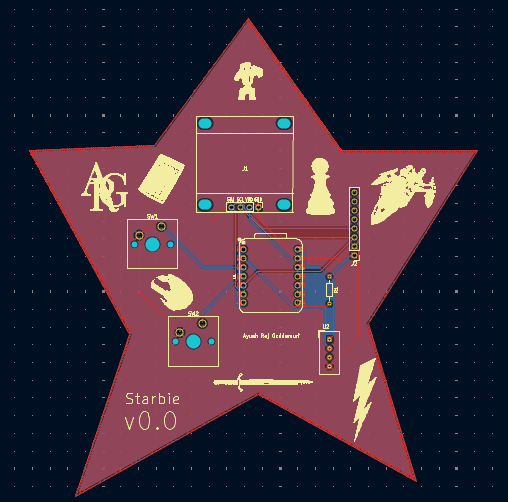

# Starbie by Ayush Raj Geddamuri
## Week 1 Half-Life Guided Project
Starbie is a project that utilizes a pcb and microcontroller to simulate an emoji that is capable of having different emotions
and actions. It has an oled screen and motion sensor to allow it to interact with the user.

## Requirements
First it is essential to understand that Starbie is made specifically to be run using the PCB in this repository as well as using the code in the Starbie.ino file. You can modify the code to run on your own firmware, but it is not meant to. Thus, the requirements are:
1. Have the right PCB
2. Contain the correct code with arduino ide, so you can upload the code into the esp32
3. Have a usb c cable capable of data transfer to allow for the uploading of your code

## Installation Instructions
1. Buy all the hardware parts required to make Starbie
2. Send the pcb layout out to get created
3. Assemble the project
4. Download the code and set up arduino ide to allow for the uploading of the program
5. Debug any errors
6. Launch the program

## Usage
I have not yet built Starbie, so this repository will likely be filled with bugs, so it will be ideal to wait for a couple weeks for replication. Also, I have no practical understanding on the use cases so far, so I will leave this section mostly blank.

## Configuration
This is not really that much things to configure except for maybe the port numbers of the microcontroller inside Starbie.ino.

## Project Status
The project is currently in a development stage without any tangible products.

## Acknowledgements
This project was built following the guide for HackClub's Half-Life program. It was built solely by Ayush Raj Geddamuri, but he used some youtube tutorials and help from the half-life team through the Hack Club Slack Channels.
